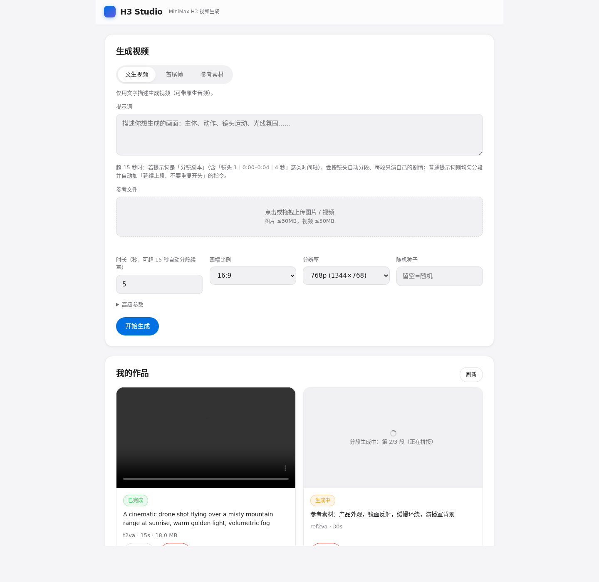

# H3 Studio

一个可自托管的 **MiniMax H3 视频生成站**：用户用**邮箱注册 / 激活 / 登录**，然后用
**一段文字**，或**图片 / 视频参考素材**，调用你自建的 H3 接口生成视频。

- 参考站点交互：<https://pixo.video/zh/blog/minimax-h3-prompts>（提示词写法与场景）
- 模型接口：vLLM-Omni 的 OpenAI 兼容视频 API（`/v1/videos/sync`）
- 纯 Node.js + 内置 SQLite，**无需任何原生依赖**，三种部署形态开箱即用

---

## 功能

- **邮箱注册 / 激活 / 登录 / 找回密码**（SMTP 发信，含激活链接与重置链接）
- **三种生成模式**（对应 H3 的三个 task）：
  | 模式 | 说明 | 参考文件 |
  |---|---|---|
  | `t2va` 文生视频 | 纯文字生成（含原生音频） | 无 |
  | `fl2va` 首尾帧 | 1 张（首帧）或 2 张（首帧+末帧） | `input_reference` 图片 |
  | `ref2va` 参考素材 | 参考图片 / 视频片段（可混合） | `input_reference` 图片/视频 |
- **突破 15 秒**：时长可填 **4–1800 秒**（上限由 `MAX_DURATION_SEC` 控制），超过 15 秒时后端自动分段续写并拼接（见下文）
- **排队提示**：多用户时任务串行排队，界面显示「第 N 位（共 M 个排队）」与分段进度
- **作品列表**：排队 / 生成中 / 完成 / 失败 状态实时刷新，可在线播放、下载、删除
- 时长、画幅、768p/2K、采样步数、flow_shift、seed 等参数可调
- 上传体积/数量限制可配；失败自动重试 1 次

---

## 突破 15 秒限制

H3 单次生成硬上限为 **15 秒（24fps，整秒）**，这是模型本身的限制。本站采用社区公认最稳的**分段续写 + 拼接**方案（对应官方手册「方法一：音画续写」），并针对「后段重复前段」做了专门处理：

**两种分段模式（自动识别）**

1. **分镜脚本模式**（推荐）：提示词含「镜头 1｜0:00–0:04｜4 秒｜标题」这类时间轴时，自动拆出总设定与各镜头，按 ≤15 秒把相邻镜头聚成生成段；**每段只喂自己那部分剧本**，从而避免后段重演开场。
2. **普通提示词模式**：均匀分段，并给每段自动追加「承接上段、不要重复开头」的续写指令。

两种模式共同点：
- 第 1 段按用户所选模式生成；
- 第 2 段起用**上一段最后一帧**作为本段首帧（`input_reference` + `fl2va`），保证画面与动作延续；
- 全部段生成后用 ffmpeg 拼接为一条完整视频。

**示例**：29 秒、7 个镜头的分镜脚本 → 自动分 3 段（12s / 13s / 4s），每段只演自己的镜头。

> 为什么这样做：手册指出「续写跑偏会累积」，且角色一致性最好靠**每段都从参考图重新开始**。因此本方案建议对身份敏感的内容控制总段数（约 2–3 段内一致性最好）。

**依赖**：宿主机/容器需有 `ffmpeg`（本仓库 Docker 镜像已内置，静态二进制，不依赖 apt）。

---

## 目录结构

```
h3-studio/
├─ server/
│  ├─ index.js      # Express 入口 + 路由
│  ├─ config.js     # 配置（读取 .env）
│  ├─ db.js         # 内置 SQLite（node:sqlite）
│  ├─ auth.js       # 注册/登录/JWT/密码
│  ├─ mail.js       # nodemailer 发信
│  ├─ h3.js         # H3（vLLM-Omni）调用封装
│  ├─ longvideo.js  # 超过 15 秒的分段续写 + 拼接（ffmpeg）
│  └─ jobs.js       # 任务队列（含排队位次、进度）与产物落盘
├─ public/          # 前端（原生 HTML/CSS/JS，无构建步骤）
├─ scripts/probe-h3.mjs   # 探测 H3 后端连通性
├─ deploy/          # systemd 单元 + Nginx 反代示例
│  └─ k8s/          # K8s 全套清单（ConfigMap/Secret/PVC/Deployment/Service/Ingress）
├─ Dockerfile / docker-compose.yml
├─ env.internal.example / env.docker.example / env.vps.example
```

---

## 通用准备

```bash
cp env.internal.example .env   # 按部署形态选对应的模板
# 编辑 .env：H3_BASE_URL、SMTP_*、JWT_SECRET 必填
npm install
node scripts/probe-h3.mjs      # 确认能连上 H3（/health、/v1/models）
```

> 想要**不依赖邮件**、注册即可用：把 `.env` 里 `SKIP_EMAIL_VERIFICATION=true`。

---

## 版本一：内网运行（不需要域名）

```bash
cp env.internal.example .env
# 关键项：
#   PUBLIC_BASE_URL=http://<本机内网IP>:8787   # 邮件里的激活链接用它
#   H3_BASE_URL=http://192.0.2.10:8003
npm install
npm start
# 浏览器打开 http://<本机内网IP>:8787
```

后台常驻可用 `deploy/h3-studio.service`（systemd）：

```bash
sudo cp deploy/h3-studio.service /etc/systemd/system/
sudo systemctl daemon-reload && sudo systemctl enable --now h3-studio
```

---

## 版本二：Docker 运行

```bash
cp env.docker.example .env
# 若 H3 跑在宿主机：H3_BASE_URL=http://host.docker.internal:32206
docker compose up -d --build
docker compose logs -f
# 浏览器打开 http://<宿主机IP>:8787
```

数据（SQLite、上传、生成的视频）持久化在 `./data`。

---

## 版本三：公网 VPS 运行

```bash
cp env.vps.example .env
# 关键项：
#   PUBLIC_BASE_URL=https://your-domain.com
#   H3_BASE_URL=https://<你的公网H3接口>      # 你后续提供的公网视频接口
#   JWT_SECRET=<长随机串>
#   SMTP_PORT=465 / SMTP_SECURE=true
npm install && npm start          # 只监听 127.0.0.1:8787
```

用 Nginx 反代 + HTTPS：参考 `deploy/nginx.conf`（已放宽 30 分钟超时、`client_max_body_size 64m`）。

```bash
sudo cp deploy/nginx.conf /etc/nginx/conf.d/h3-studio.conf
sudo nginx -t && sudo systemctl reload nginx
```

---

## 版本四：Kubernetes 部署

一套完整清单，`kubectl apply -k deploy/k8s/` 部署。含 Namespace / ConfigMap / Secret /
PVC / Deployment / Service / Ingress，镜像用官方发布的 `cnrock/h3-studio`。

```bash
# 先改三处：01-configmap.yaml（域名/H3 地址/SMTP）、02-secret.yaml（密钥）、06-ingress.yaml（域名）
kubectl apply -k deploy/k8s/
kubectl -n h3-studio get pods,svc,ingress
```

关键约束：**必须单副本**（队列进程内串行 + SQLite 单写）；视视频生成最长 30 分钟，
Ingress 已用注解放宽读超时到 1800s；`/app/data` 挂 RWO PVC。详见 [`deploy/k8s/README.md`](deploy/k8s/README.md)。

---

## H3 接口对接说明（重要）

本站按 **vLLM-Omni 的 `/v1/videos/sync`** 规范调用，`multipart/form-data`，**同步返回 MP4 字节流**。字段：

| 字段 | 说明 |
|---|---|
| `prompt` | 提示词（≤20000 字符，可用 PROMPT_CHARS 调整） |
| `width` / `height` | 输出尺寸 |
| `aspect_ratio` | `21:9/16:9/4:3/1:1/3:4/9:16` |
| `fps` | 帧率（H3 固定 24） |
| `num_inference_steps` / `flow_shift` / `seed` | 采样参数 |
| `extra_params` | JSON：`{"task":"t2va\|fl2va\|ref2va","duration":4~15,"audio_flow_shift":3.0}` |
| `input_reference` | 参考图片/视频文件（multipart 文件部分） |
| `image_reference` | JSON：`{"image_url":"..."}`（URL 方式，与文件上传互斥） |
| `video_reference` | JSON：`{"video_url":"..."}`（URL 方式） |

你的示例命令：

```bash
curl -sS -X POST http://192.0.2.10:8003/v1/videos/sync \
  -F 'prompt="..."' \
  -F 'width=1344' -F 'height=768' -F 'aspect_ratio=16:9' \
  -F 'fps=24' -F 'num_inference_steps=50' -F 'flow_shift=12' -F 'seed=1101' \
  -F 'extra_params={"task":"t2va","duration":14.38,"audio_flow_shift":3.0}' \
  -o film.mp4
```

与本站的调用完全一致（本站把 `duration` 收敛到 4–15 秒）。

> 若你的接口需要鉴权，填 `H3_API_KEY`，会以 `Authorization: Bearer <key>` 发送。

---

## 环境变量速查

| 变量 | 默认 | 说明 |
|---|---|---|
| `DEPLOYMENT` | `internal` | 形态标识（展示用） |
| `PORT` | `8787` | 监听端口 |
| `PUBLIC_BASE_URL` | 空 | 邮件链接用的公开地址；空则按请求 Host 推断 |
| `H3_BASE_URL` | `http://192.0.2.10:8003` | H3 后端地址 |
| `H3_API_KEY` | 空 | 后端鉴权（可选） |
| `H3_TIMEOUT_MS` | `1800000` | 同步生成超时（30 分钟；长视频分段会累加） |
| `JWT_SECRET` | 开发串 | **生产必改** |
| `SKIP_EMAIL_VERIFICATION` | `false` | `true` 则注册即可用 |
| `SMTP_*` | — | 见模板；含 `SMTP_TLS_REJECT_UNAUTHORIZED` |
| `MAX_IMAGE_MB` / `MAX_VIDEO_MB` / `MAX_FILES` / `PROMPT_CHARS` | 30/50/9/20000 | 上传与提示词限制 |

---

## 常见问题

**构建时容器内 Node 崩溃 `Assertion failed: uv_thread_create` / `core dumped`（exit 134）**
旧版 Docker（< 20.10.10，如 20.10.7）的 seccomp 策略会拦 `clone3`，新 glibc 的 Node 一创线程就崩。二选一：
1. 本仓库已默认用 `node:22-bullseye-slim`（glibc 2.31，不走 `clone3`）——**推荐，无需动宿主机**；
2. 或在 `docker-compose.yml` 打开 `security_opt: [seccomp:unconfined]`；
3. 或升级宿主机 Docker 到 ≥ 20.10.10。

**邮箱收不到激活邮件**
1. 先看 `curl -s localhost:8787/api/health` 里 `smtp.ok`；
2. 25 端口常被云/内网挡，改 `SMTP_PORT=465` + `SMTP_SECURE=true`；
3. 密码要用邮箱服务商生成的**授权码**，不是登录密码；
4. 也可临时设 `SKIP_EMAIL_VERIFICATION=true` 重启容器。

---

## 已做的验证

- 服务器启动、`/api/health`、静态页面、注册（免激活模式）、登录、错误密码、令牌鉴权均通过
- 任务提交 → 入队 → 执行 → （后端不可达时）状态置 `error` 并记录原因，链路完整
- 前端为无构建的原生实现，直接由 Express 托管

> 生成结果的真实成功链路需在能连通 H3 的机器上验证（本机跨网段访问不到 `192.0.2.10`）。
> 请先跑 `node scripts/probe-h3.mjs --gen` 做一次最小生成。

---

## 界面（v1.6 · Apple 风格）

参考 Apple 设计语言重构：浅色为主 / 深色为精致对偶、毛玻璃顶栏、胶囊按钮、大留白、
精确字距与柔和多层阴影；登录页与应用页（生成表单、作品网格）统一。配色自动跟随系统深浅色。



## 免责声明

本项目仅用于内部/学习用途。生成的视频由你自建的 H3 模型产出，请遵守相关许可与合规要求。

---

## 安全说明

> 用后即弃会话：令牌存 `HttpOnly` cookie（非 `localStorage`），退出登录即时清 Cookie；
> 密码用 bcrypt 哈希存储，重置令牌 1 小时过期且一次性。

### 已内置的防护
- `/api/health` 仅回 `{ok:true}`；后端地址等详情移入需登录的 `/api/health/detail`
- 安全响应头：`X-Content-Type-Options`、`X-Frame-Options`、`Referrer-Policy`、`Permissions-Policy`、CSP，并关闭 `X-Powered-By`
- 限速：同 IP 登录 10 次/10 分钟、注册 5 次/小时、找回密码 5 次/小时（超出 429）
- 生成/任务/视频接口均需登录鉴权（401）

### 凭据不进 URL（v1.6.3）

登录/注册/找回密码表单均显式声明 `method="post"` 并由 JS 以 `fetch` POST 提交，
凭据只走请求体。服务端另加一道兜底：任何带 `password`/`email` 等字段的 **GET** 请求
一律 `303` 重定向到干净路径，把凭据从浏览器历史 / Referer / 反代与服务器访问日志中剔除
（`/api/` 下的 JSON 接口与 `reset`/`verify` 的合法 token query 不受影响）。
HTML 页面向应 `Cache-Control: no-store`，避免旧版页面（旧版表单会原生 GET 提交）被复用。

> 若你在反代（Nginx）开启了访问日志，且历史上有过这类带凭据的 GET 请求，
> 建议清理对应日志段；并确认 `Referrer-Policy: no-referrer` 生效（已内置）。

### 部署必做
1. **改 `JWT_SECRET`** 为随机长串（默认值可被伪造 token）
2. **H3 后端不要暴露公网**：`<你的H3内网地址:端口>` 应只允许本机/内网访问
   （建议安全组/防火墙只放行 H3 Studio 所在主机，或仅监听内网）
3. **上 HTTPS**：公网部署务必用 Nginx + Let's Encrypt，并设 `ENABLE_HSTS=true`
   （同时会自动给 Cookie 加 `Secure`）
4. 生产环境设置 `SKIP_EMAIL_VERIFICATION=false`，并保证 SMTP 可用

---

## 长视频失败的排查（重要）

若长视频（>15 秒）在后段失败并**从头重跑**，看 H3 日志会发现：每段生成其实都成功了，
但客户端在第 2 段（约 300 秒处）就报错重试。

**根因**：Node 内置 `fetch`（undici）的 **`headersTimeout` 默认 300 秒**。
H3 单段 12~13 秒视频要 4~6 分钟，第 1 段（≈262s）能过，第 2 段（≈325s）就被 undici
掐断，报 `UND_ERR_HEADERS_TIMEOUT`，触发重试。

**修复**：`server/h3.js` 用独立 `undici.Agent`，把 `headersTimeout`/`bodyTimeout`
放宽到 `H3_TIMEOUT_MS`（默认 30 分钟）。仅设 `AbortController` 是无效的——两者是
独立超时。

其余加固：
- 长视频改为**逐段重试**（只重跑失败段，已成功段复用），不再整条从头重跑
- 抽取上段末帧失败时，自动退化为纯文本续写，不中断整条流程

> K8s 侧无需改动：`VLLM_OMNI_VIDEO_SYNC_TIMEOUT=14400` 已足够，问题在网站客户端超时。

---

## 错误排查：ref2va 报错 / prompt 丢失

### 1) `checkpoint partition 'fl2va' supports ['fl2va','t2va'], got task='ref2va'`
这是 **H3 服务端（K8s）配置问题**，与本网站无关。

原因：`vllm serve` 命令里带了 `--task-type fl2va`，只加载了 FL2VA 一个 DiT；
参考素材（ref2va）需要 Ref2VA 那个 DiT，因此被拒绝。

修复（改 deployment 的 args）：
- **去掉 `--task-type fl2va`**，让服务同时加载两个 DiT（180GB 卡足够）；
- serve 路径指向**仓库根目录**，而不是 `FL2VA/` 子目录。

> ⚠️ 注意：这么改之后，若根目录残留 FastH3 标记文件，服务会起不来——请一并阅读
> 下文「serve 根目录残留 FastH3 标记文件，服务无法启动」。

```yaml
args:
  - |
    exec vllm serve /data/serving-model/MiniMax-H3 \
      --omni \
      --host 0.0.0.0 --port 8003 \
      --trust-remote-code --served-model-name minimax-h3 \
      # ...其余参数不变，注意【不要】再加 --task-type
```

服务重启后 `{"task":"ref2va"}` 即可正常调用。

### 2) `body.prompt Field required, input: 'None'`
这是 **v6 的代码缺陷**（v7 已修）：v6 为实现长超时引入了 `undici` npm 包，
它与 Node 内置的 `FormData` 不兼容——请求体被当成普通对象字符串化成
`[object FormData]`（仅 17 字节），H3 收不到任何字段。

v7 已**移除 undici 依赖**，改用 Node 内置 `http/https` 自行构造 multipart，
超时仍完全可控，且无额外依赖。

---

## 错误排查：ref2va 报 "accepts at most 3 video references"

**根因**：H3 的 multipart 参考字段名分单复数两种，用错会导致参考数量统计错乱。

| 场景 | 正确字段名 |
|---|---|
| ref2va（参考素材，图/视频混合，可多个） | **`input_references`**（复数） |
| fl2va 单帧 | `input_reference`（单数） |
| fl2va 首+末两帧 | `input_references`（复数） |

若把多文件都塞进单数 `input_reference`：FastAPI 只保留最后一个文件，且视频会被
解码成帧序列，被 H3 当成「多个视频参考」→ 报
`ref2va accepts at most 3 video references`。

网站已按上表自动选择字段名（`server/index.js`）。参考上限（H3 侧）：
图片 ≤9、视频 ≤3、独立音频 ≤3、总数 ≤12；**每个参考视频时长 2–15 秒、参考视频合计 ≤15 秒**
（超长会自动截取，见下文）。

---

## 错误排查：ref2va 报 "reference video 0 duration must be in [2, 15] seconds"

**症状**：ref2va 模式（带参考图/参考视频）生成失败，第 1 段就报
`H3 返回 500：{"error":{"message":"Video generation failed: reference video 0 duration must be in [2, 15] seconds, got 157.500"...}}`；
而**纯文本（t2va）同样时长却正常**。

**根因**：H3 对 ref2va 的每个参考视频有硬校验——时长必须 ∈ [2,15] 秒，且所有参考视频
合计 ≤15 秒。用户上传的整段长视频（如 157.5 秒）被原样转发给 H3，直接被拒。
t2va 不带任何参考文件，不触发此校验，所以「纯文本能成、带参考就挂」。

**已修（v1.6.2）**：提交前统一规整参考视频（`server/longvideo.js` 的 `normalizeReferenceVideos`）：

1. 用 `ffprobe` 探测每个参考视频时长；
2. 超过上限的，**重编码截取**到允许长度（`-c copy` 会按关键帧切到 15.2s，仍超限，
   故必须重编码；并留 0.1s 余量避开浮点边界）；
3. 多视频按**剩余总时长预算**动态收敛，保证合计 ≤15 秒；
4. 短于 2 秒的片段直接给出明确报错，提示换用更长的片段。

前端同样在提交前预检并提示（超长会提示「已自动截取前 15 秒」）。

> 上传限制（`MAX_REF_VIDEO_SEC`，默认 15）可在 `.env` 调整；**不要**设成 >15，
> 因为 H3 后端硬上限就是 15 秒。

---

## 三种模式全支持：多后端路由

H3 每个服务进程只加载一个分区，分区决定可用任务：

| serve 路径 | 支持任务 | 端口示例 |
|---|---|---|
| `.../FL2VA` + `--task-type fl2va` | `t2va`、`fl2va` | 8003 |
| `.../Ref2VA` + `--task-type ref2va` | `ref2va` | 8004 |

错误 `checkpoint partition 'ref2va' supports ['ref2va'], got task='t2va'` 就是
「把 t2va 发给了只服务 ref2va 的后端」。

**要三种模式全支持，跑两个 H3 服务，并在网站配置：**

```ini
# 默认后端（serve FL2VA 分区）：承载 t2va / fl2va
H3_BASE_URL=http://<host>:8003
# ref2va 专用后端（serve Ref2VA 分区）
H3_BASE_URL_REF2VA=http://<host>:8004
H3_REF2VA_API_KEY=          # 若该后端需要鉴权
```

网站会按 `mode` 自动路由：`ref2va` → `H3_BASE_URL_REF2VA`，其余 → `H3_BASE_URL`。
若 `H3_BASE_URL_REF2VA` 留空，则所有任务都发往默认后端（旧行为，兼容单后端部署）。

---

## 错误排查：serve 根目录残留 FastH3 标记文件，服务无法启动

**症状**：去掉 `--task-type`、并让 `vllm serve` 指向仓库根目录后，服务起不来，Orchestrator
初始化报 `ValueError: FastH3 V2 requires --diffusion-attention-backend FASTVIDEO_VSA`。

**根因**：根目录残留了 FastH3 的标记文件，导致 H3 把普通权重误判为 FastH3 模块化版本。

- `checkpoint.py::is_minimax_h3_modular()` 的判定是「目录下存在
  `modular_model_index.json` **或** `fastvideo_inference.json`」即视为 modular；
- 未显式指定 `--task-type` 时其默认值为 `auto`，而 `pipeline_minimax_h3.py` 中
  `if modular and task_type == "auto": self.partition = "fl2va"`，于是走进 FastH3 契约校验；
- `fasth3_checkpoint.py::check_serving_contract()` 是**硬校验**，无开关可跳过，
  只接受 `--diffusion-attention-backend FASTVIDEO_VSA`，否则抛错、进程退出。

**修复（推荐，保留单进程三任务）**：把标记文件移出 serve 根目录，走非 modular 分支即可
同时支持 `t2va` / `fl2va` / `ref2va`：

```bash
cd <serving-model-path>
mkdir -p _fasth3_markers_backup
mv fastvideo_inference.json modular_model_index.json provenance.json _fasth3_markers_backup/ 2>/dev/null
```

保持「serve 根目录 + 不加 `--task-type` + 原 `--diffusion-attention-backend`」，重启后
`curl http://<host>:8003/health` 应正常。

**若确实要用 FastH3 V2（8 步蒸馏版）**：保留标记文件，但必须同时加
`--task-type fl2va --diffusion-attention-backend FASTVIDEO_VSA`，且此后仅 `fl2va` / `t2va`
可用，`ref2va` 不可用。

**兜底方案**：起两个进程分别 serve 子目录（`FL2VA` + `--task-type fl2va` → 8003；
`Ref2VA` + `--task-type ref2va` → 8004），前提是子目录内不含上述标记文件。

---

## 重新生成（失败重试）

失败的任务卡片上会出现 **「重新生成」** 按钮（在「删除」左边），点击即把该任务
重新入队，**无需重新上传参考文件或重填提示词**。

- 失败时服务端**保留**参考文件，供重生成复用（文件在该任务被删除时才清理）。
- 若参考文件已丢失，重生成会提示「参考文件已不在，请重新上传后再提交」。
- 生成中/排队中的任务不能重复触发（返回 409）。

---

## 错误排查：长视频（>15 秒）第 1 段报 "t2va does not accept image/video/audio conditions"

**根因（已修复）**：长视频分段时，第 1 段的模式被硬编码为 `t2va`，但仍带上了用户
上传的参考文件 → `t2va` 不允许任何图/视频/音频条件 → 报错。

正确行为（现版本）：

| 段 | 模式 | 参考文件 |
|---|---|---|
| 第 1 段 | 用户所选（t2va/fl2va/ref2va） | 用户上传的原始参考 |
| 后续段 · 抽帧成功 | `fl2va` | 上一段末帧 |
| 后续段 · 抽帧失败 | `t2va` | 无 |

这也解释了「15 秒能成功、超过 15 秒失败」——单段走另一条保留原模式的路径。

### 附带修复：ffmpeg 版本兼容
分段归一化原先用了 `-fps_mode cfr`，该选项仅 ffmpeg 5+ 支持；宿主机为 4.4 时会报
`Unrecognized option 'fps_mode'`。已改为 `-vsync cfr`（4.x 与 5+/7.x 均兼容）。

---

## 修复：长视频在段边界播放中断（v12）

**症状**：拼接后的长视频播放到某处（如 29 秒视频的 ~15 秒）卡住，往后拖又能看到画面。

**根因**：段边界时间戳不连续。v11 虽已"逐段归一化"，但拼接仍用 `-c copy`
流拷贝——即使各段时间戳已归零、帧率固定，AAC 编码器延时与容器时长误差仍会在
段边界留下 0.02~0.07s 的间隙。

**实测对比**（12s+13s+4s 三段）：

| 拼接方式 | 段边界间隙 |
|---|---|
| 归一化 + `-c copy`（v11） | ❌ 有 |
| 归一化 + **重新编码**（v12） | ✅ 无 |

**修复**：拼接阶段改为重新编码（`-c:v libx264 -c:a aac -vsync cfr`），
保证一条连续时间轴；输出加 `-movflags +faststart` 便于边下边播。

---

## 长视频上限与资源（v13）

**时长上限**：由 `MAX_DURATION_SEC` 控制（默认 1800 = 30 分钟）。H3 单段硬上限 15 秒，
超出部分自动分段续写 + 拼接。旧版本硬编码 120 秒，v13 起可配置。

**内存**：v13 起，成片**直接落盘**（`fs.renameSync`），不再用 `readFileSync` 把整片读进内存。
实测各环节内存：

| 环节 | 峰值内存 | 与时长关系 |
|---|---|---|
| ffmpeg 归一化（单段） | 约 60~100 MB | 仅与**单段**有关，恒定 |
| ffmpeg concat 拼接 | 约 100 MB（3 分钟实测） | 流式解复用，**几乎与总时长无关** |
| 网站进程 | 旧版会整片进内存 → 已修 | v13 后恒定 |

因此 **1~2 GB 内存的机器也能拼接很长时间的视频**——瓶颈不在 ffmpeg 内存，
而在生成耗时与磁盘。

**磁盘**：1344×768 / crf18 下，成片约 26 MB/分钟 → 30 分钟约 0.8 GB，
另有等量的分段中间文件（任务结束即清理）。

**生成耗时（真正的瓶颈）**：H3 单段 15 秒约 4~6 分钟 →
- 5 分钟视频 ≈ 20 段 ≈ 1.5~2 小时
- 30 分钟视频 ≈ 120 段 ≈ 10~12 小时

---

## 修复：拼接报 "Unrecognized option 'vsync'"（v14）

固定帧率选项名随 ffmpeg 版本而异，写死任一个都会在某些版本上崩：

| ffmpeg | `-fps_mode` | `-vsync` |
|---|---|---|
| 4.x | ❌ | ✅ |
| 5~7 | ✅ | ✅（弃用别名） |
| **8+/9.x** | ✅ | ❌ **已移除** |

v14 起**运行时探测一次**（`ffmpeg -h full` 里找 `fps_mode`，退而 `vsync`，
都没有则仅用 `-r 24`）并缓存，兼容全部版本。抽帧处也去掉了该选项。
